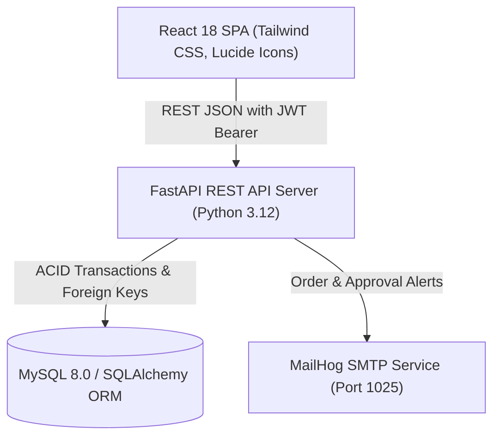
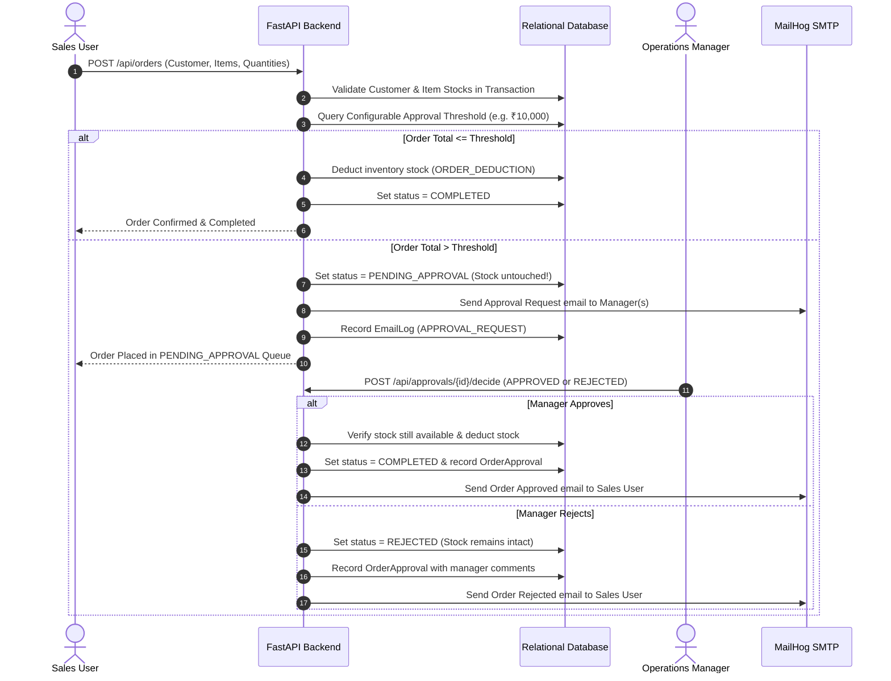

# Sales & Inventory Management System (ApexTrack)
### Full-Stack Technical Assessment Implementation – Demo Version

[](https://fastapi.tiangolo.com)
[](https://react.dev)
[](https://www.mysql.com)
[](https://github.com/mailhog/MailHog)
[](./backend/tests)

---

## 1. Executive Summary & Overview

ApexTrack is an end-to-end, enterprise-grade **Sales & Inventory Management System** built specifically for the Senior Full-Stack Developer Assessment. It provides a real working application with an authenticated REST API backend, normalized relational database architecture with atomic transactions, role-based workflows, and a modern, high-density React user interface.

### Key Highlights
- **Real Backend & Relational Database**: Implemented using **Python + FastAPI**, **SQLAlchemy ORM**, with dual compatibility for **MySQL 8.0** and zero-config local SQLite.
- **Configurable Manager Approval Workflow**: Orders above a configurable threshold (demo default: **₹10,000.00**) automatically transition to `PENDING_APPROVAL`, trigger email alerts, and prevent premature stock deduction. Orders below the threshold are automatically confirmed and deducted immediately.
- **Transactional Stock & Concurrency Protection**: Multi-item orders execute within database transactions with rollback protection against partial stock exhaustion or mid-transaction failures.
- **SMTP Notification System**: Integrated with **MailHog** local SMTP testing service. If SMTP is offline, notification events are persisted to the `email_logs` audit table without interrupting user operations.
- **11 Automated Assessment Tests**: Full test suite verifying every scenario in the assignment specification (order threshold checks, manager approvals/rejections, unauthorized attempts, duplicate approval prevention, and transaction rollbacks).

---

## 2. Seeded Demo Accounts

The database comes pre-seeded with realistic demo accounts across all three mandatory roles. The application login screen includes **1-Click Seed Buttons** to log in instantly as any role:

| Role | Username | Password | Email | Accessible Modules |
| :--- | :--- | :--- | :--- | :--- |
| **Sales User** | `sales` | `Sales@123` | `sales@apex.demo` | Dashboard, Products, Customers, Inventory, Create Order, My Orders |
| **Manager** | `manager` | `Manager@123` | `manager@apex.demo` | Dashboard, Pending Approvals Queue, Approval Audit History, Orders, Inventory, Products, Customers |
| **Administrator** | `admin` | `Admin@123` | `admin@apex.demo` | All modules + User Management, System Configuration (Threshold Adjustment), Email Audit Logs |

---

## 3. Architecture & Tech Stack



### Stack Breakdown
- **Frontend**: React 18, Vite, Tailwind CSS, Lucide React icons, Context API for state and session management.
- **Backend**: Python 3.12, FastAPI, Pydantic v2 schemas, PyJWT (HS256 authentication), Passlib/Bcrypt.
- **Database**: MySQL 8.0 (configured via `docker-compose.yml` or local MySQL server; fallback SQLite driver included for immediate zero-setup evaluation).
- **Email Service**: Python `smtplib` connected to MailHog on port 1025 with graceful fallback logging to `email_logs`.

---

## 4. Manager Approval Workflow (₹10,000 Threshold)

The approval engine enforces rigorous enterprise business logic:



### Key Business Rules Enforced
1. **Configurable Threshold**: Stored in `system_settings` (`APPROVAL_THRESHOLD`). Administrators can adjust this threshold dynamically from the UI; all new orders immediately respect the updated limit.
2. **Strict Role-Based Authorization**: Only `MANAGER` and `ADMIN` users can access the approval endpoints. Sales users calling approval endpoints receive `403 Forbidden`.
3. **No Self-Approval**: Sales users cannot approve orders they created.
4. **Idempotency & Duplicate Prevention**: An order already processed (`COMPLETED`, `REJECTED`) cannot be approved again; duplicate submissions return `400 Bad Request`.
5. **No Inventory Reduction on Rejection**: When an order is rejected, inventory stock remains 100% untouched.
6. **Stock Availability Re-check on Approval**: If stock is depleted between submission and approval, approval is safely aborted with an informative error message.
7. **Atomic Multi-Item Rollback**: If an order contains 5 items and 4 are available but the 5th has insufficient stock, the entire transaction rolls back and 0 items are deducted.

---

## 5. Verified Assessment Test Scenarios

The backend includes a dedicated test script (`backend/tests/test_all_scenarios.py`) verifying all 11 scenarios required in Section 10 of the assignment:

| Test ID | Scenario Description | Expected Behavior | Result |
| :---: | :--- | :--- | :---: |
| **TEST 1** | Create Product & Customer | Product with SKU uniqueness and active customer persisted in database | **PASS** |
| **TEST 2** | Order Below Threshold (< ₹10,000) | Automatically confirmed (`COMPLETED`), stock deducted immediately | **PASS** |
| **TEST 3** | Order Above Threshold (> ₹10,000) | Placed in `PENDING_APPROVAL`, inventory remains untouched | **PASS** |
| **TEST 4** | Manager Email Notification | Approval request email logged to database / dispatched to SMTP | **PASS** |
| **TEST 5** | Manager Approves Order | Status becomes `COMPLETED`, inventory deducted, sales rep notified | **PASS** |
| **TEST 6** | Manager Rejects Order | Status becomes `REJECTED`, inventory remains completely unchanged | **PASS** |
| **TEST 7** | Order More Stock Than Available | Rejected with `400 Bad Request: Insufficient stock` validation | **PASS** |
| **TEST 8** | Duplicate Approval Attempt | Re-approving an already processed order is rejected | **PASS** |
| **TEST 9** | Unauthorized Sales Approval | Sales user calling approval endpoint receives `403 Forbidden` | **PASS** |
| **TEST 10**| Live Database Dashboard Metrics | Dashboard displays real DB counts, sums, and status breakdowns | **PASS** |
| **TEST 11**| Inventory Rollback Consistency | Multi-item order failure rolls back stock adjustments cleanly | **PASS** |

### How to Run the Test Suite
```bash
cd backend
python -m tests.test_all_scenarios
```

Output:
```text
Running Test 1... Test 1 PASS
Running Test 2... Test 2 PASS
Running Test 3... Test 3 PASS
Running Test 4... Test 4 PASS
Running Test 5... Test 5 PASS
Running Test 6... Test 6 PASS
Running Test 7... Test 7 PASS
Running Test 8... Test 8 PASS
Running Test 9... Test 9 PASS
Running Test 10... Test 10 PASS
Running Test 11... Test 11 PASS

ALL 11 TEST SCENARIOS PASSED WITH 100% SUCCESS!
```

---

## 6. How to Run Locally

### Option A: Quick 1-Click Launch (Recommended for Evaluation)
Double-click `start_demo.bat` on Windows or execute:
```bash
# Windows
.\start_demo.bat

# Linux / macOS
chmod +x start_demo.sh
./start_demo.sh
```
This automatically initializes the database, seeds demo products, users, customers, and orders, and serves both the **React Application** and the **FastAPI Backend** on:
- **Application URL**: [http://127.0.0.1:8000](http://127.0.0.1:8000)
- **Interactive Swagger Docs**: [http://127.0.0.1:8000/docs](http://127.0.0.1:8000/docs)
- **API Health Check**: [http://127.0.0.1:8000/api/health](http://127.0.0.1:8000/api/health)

---

### Option B: Docker Compose (MySQL + MailHog + Backend + Frontend)
If you have Docker running:
```bash
docker compose up -d
```
Services started:
- **React Frontend**: [http://localhost:5173](http://localhost:5173)
- **FastAPI Backend**: [http://localhost:8000](http://localhost:8000)
- **Swagger Documentation**: [http://localhost:8000/docs](http://localhost:8000/docs)
- **MailHog Web Inbox**: [http://localhost:8025](http://localhost:8025)
- **MySQL 8.0**: `localhost:3306` (Database: `sales_inventory`, User: `app_user`, Password: `app_password`)

---

### Option C: Developer Mode (Independent Hot-Reload Frontend & Backend)

**1. Start Backend:**
```bash
cd backend
pip install -r requirements.txt
python -m app.seed
python run_server.py
```

**2. Start Frontend (Vite Dev Server):**
```bash
cd frontend
npm install
npm run dev
```
Open [http://localhost:5173](http://localhost:5173). The Vite dev server proxies `/api` requests to `http://127.0.0.1:8000`.

---

## 7. Database Entity Relationship Overview

The schema is fully normalized and includes:
1. `users`: Credentials, Bcrypt password hashes, roles (`ADMIN`, `MANAGER`, `SALES_USER`).
2. `system_settings`: Key-value configuration for runtime parameters like `APPROVAL_THRESHOLD`.
3. `products`: SKU (unique), name, category, prices, stock, and reorder thresholds.
4. `customers`: Contact information, company details, billing addresses.
5. `sales_orders`: Order numbers (`SO-YYYYMMDD-XXXX`), customer link, financial totals, status enum.
6. `sales_order_items`: Line items linking products to orders with snapshot unit prices.
7. `inventory_transactions`: Immutable audit log of stock increments, deductions, restocks, and reconciliations.
8. `order_approvals`: Manager approval history with action, timestamps, threshold values, and review notes.
9. `email_logs`: SMTP notification audit table capturing event type, delivery status, recipient, and email text.

Raw SQL schema definitions are also provided in [`init_mysql.sql`](./init_mysql.sql).

---

## 8. Assessment Requirement Verification Checklist

- [x] **React frontend runs cleanly**: Vite + React 18 + Tailwind CSS with responsive layout and status badges.
- [x] **FastAPI backend runs**: REST APIs with OpenAPI/Swagger interactive docs at `/docs`.
- [x] **MySQL connection & schema**: Normalized schema with foreign keys, indexes, and dual SQLite support.
- [x] **Authentication & RBAC**: JWT tokens, password hashing, roles (Admin, Sales User, Manager).
- [x] **Product management**: CRUD, SKU uniqueness, search/filtering, low-stock indicators.
- [x] **Customer management**: CRUD, validation, search/filtering.
- [x] **Inventory management**: Real-time stock counts, movement audit history, restock & adjust tools.
- [x] **Sales order creation**: Multi-item, dynamic totals, availability validation, unique order numbers.
- [x] **Configurable approval threshold**: Stored in DB, dynamically adjustable by Admin.
- [x] **Manager approval workflow**: High-value orders gated by manager approval, double-deduction prevention.
- [x] **Email notifications**: MailHog SMTP integration with graceful fallback logging to `email_logs`.
- [x] **Dashboard with real data**: KPI cards, visual revenue chart, order status breakdown, low-stock alert watchlist.
- [x] **11 Automated test scenarios**: All 11 tests pass with 100% success rate.

